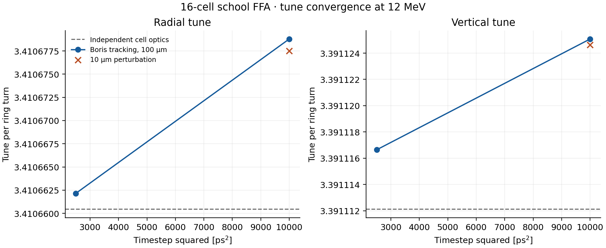

# Tunes of the 16-cell school ring

This workflow measures radial and vertical tunes from ordinary OPALX particle
tracking about the fixed-12 MeV closed orbit. It uses cell-plane samples and
paired position/momentum signals, so the integer ring tune and the f versus 1-f
alias are resolved explicitly. The legacy cyclotron `SPECTRALTUNES` mode is
unchanged; this is a reproducible school analysis workflow using production
Boris tracking and the existing experimental passive plane recorder.

## Independent linear optics

`school_linear_optics.py` integrates the median-plane orbit together with the
horizontal and vertical variational maps over one cell. The Enge field and its
analytic radial/azimuthal gradients are evaluated independently of OPALX. With
normalized radial momentum u, tangential momentum v=sqrt(p0²-u²), radius r,
a=c/mass_eV and median-plane field B, the horizontal generator is

```
A_r = [[u/v,                 r*p0^2/v^3],
       [-a*(B+r*dB/dr),      -u/v]]
```

Maxwell's curl equation gives the first-order off-plane components
B_r=y*dB/dr and B_phi=y/r*dB/dphi. The vertical generator is therefore

```
A_y = [[0, r/v],
       [a*(r*dB/dr-u/v*dB/dphi), 0]]
```

The cell matrices have determinant one. Their matched Courant-Snyder alpha and
beta define a complex signal `z=q-i*(alpha*q+beta*p)`. Its positive frequency
tracks forward phase. Continuous phase unwrapping through the cell establishes
its integer winding, which a matrix trace alone cannot determine. The continuously resolved cell phase establishes that this lattice has less
than one phase winding per cell. Multiplying the measured cell tune by 16 then
gives the ring tune; cell sampling alone would still alias additional whole
windings per cell without this optics check.

The independent infinitesimal-amplitude predictions are approximately
**Qr=3.4106604514** and **Qy=3.3911121264**. Refining the ODE tolerance and halving
its maximum angular step changes these values by less than 4e-14. These changes
measure integration consistency, not uncertainty in the legacy lattice model.
Raising the cell maps to the 16th power agrees with the stored full-ring COF
Jacobian within 2.7e-9 horizontally and 7.8e-7 vertically; the latter comparison
includes the stored map's finite-difference truncation error.

## Production particle experiment

`school_tunes.py` creates eight deterministic FROMFILE particles:

- One closed reference and a coincident duplicate.
- Opposite radial displacements, opposite vertical displacements, and an
  opposite pair displaced in both planes.

All have the same full mechanical momentum as the COF solution, hence the same
12 MeV kinetic energy. No radial momentum is added on top of a full reference
momentum. Field solver NONE disables collective forces.

Sixteen planes at equal 22.5° intervals record accepted endpoint crossings.
Their normals select the forward ring crossing, excluding the opposite arm.
Each perturbed record is paired with the tracked reference at the same cell
plane and passage count. Raw laboratory coordinates are converted to radius,
radial momentum and vertical position/momentum. Missing particles, duplicate
crossings and gaps in the expected cell-index sequence are errors.

The initial and final partial turns are omitted. A 50-turn run supplies 48
complete analysis turns (768 samples per particle); a 25-turn run supplies 23.
The plane at launch has its first recorded forward crossing at cell 16, whereas
planes 1–15 have their first crossing in the first cell cycle. The scripts
account for that difference and map interleaved MPI IDs back to FROMFILE rows.

After reference subtraction, each complex signal is mean-subtracted and Hann
windowed. A zero-padded complex spectrum locates the dominant frequency, then a
local continuous projection fit refines it. Both frequency orientations remain
available; no arbitrary reflection of a real-signal peak is applied. Radial and
vertical estimates average the opposite displacement results. This estimator
is explicitly not presented as PyNAFF or the legacy SEO Lomb calculation.

## Reproduction

Use the OPALX Python environment and an executable built from this branch.
Each output directory must be new:

```sh
PY=~/.venv-h6/bin/python
EXE=/absolute/path/to/build/src/opalx
$PY docs/validation/scaling-ffa/school_linear_optics.py --output /tmp/ffa-linear.json
$PY docs/validation/scaling-ffa/school_tunes.py --output /tmp/ffa-tune-coarse --executable "$EXE" --turns 50 --dt 1e-10 --amplitude 1e-4
$PY docs/validation/scaling-ffa/school_tunes.py --output /tmp/ffa-tune-fine --executable "$EXE" --turns 50 --dt 5e-11 --amplitude 1e-4
$PY docs/validation/scaling-ffa/school_tunes.py --output /tmp/ffa-tune-small --executable "$EXE" --turns 25 --dt 1e-10 --amplitude 1e-5
$PY docs/validation/scaling-ffa/school_tunes.py --output /tmp/ffa-tune-mpi --executable "$EXE" --turns 25 --dt 1e-10 --amplitude 1e-4 --ranks 2
$PY docs/validation/scaling-ffa/compare_school_tunes.py --coarse /tmp/ffa-tune-coarse --fine /tmp/ffa-tune-fine --small /tmp/ffa-tune-small --mpi /tmp/ffa-tune-mpi --output /tmp/ffa-tune-report
```

Inputs, particle file, recorder configuration, raw crossing CSV, run log and
`tunes.json` are retained in each run directory. `--analyze-only` recomputes
estimates without tracking; `--window-turns` selects a shorter complete analysis
interval. The comparison checks spectral record length, amplitude, timestep,
MPI agreement and per-ID sample consistency, and produces a convergence figure.
Boundary refinement and endpoint recording make these long runs substantially
more expensive than the short COF example; each rank uses one OpenMP thread.

Analysis regressions can be run without launching OPALX:

```sh
~/.venv-h6/bin/python -m unittest discover -s docs/validation/scaling-ffa -p test_school_tunes.py -v
```

They test both complex frequency orientations with counter-rotating contamination,
invalid input rejection, independently differenced profile gradients, and
one-cell/full-ring map consistency. Existing pusher and optics tolerances are
unchanged. Convergence criteria in `compare_school_tunes.py` are explicit new
acceptance checks for this diagnostic, not alterations to OPALX physics.

## Recorded results and limits

| Method | Radial Qr | Vertical Qy |
|---|---:|---:|
| Independent linear cell optics | 3.4106604514 | 3.3911121264 |
| 50 turns, 100 ps, 100 µm | 3.4106787903 | 3.3911250744 |
| 50 turns, 50 ps, 100 µm | 3.4106621506 | 3.3911166446 |
| 25 turns, 100 ps, 10 µm | 3.4106775038 | 3.3911246348 |
| 25 turns, 100 ps, 100 µm, two ranks | 3.4106786254 | 3.3911251285 |



[Vector figure](school-tunes.pdf), [linear-optics snapshot](school-linear-optics.json)
and [full numerical validation](school-tune-validation.json) are included.
The line joins the two timestep measurements; it is not an extrapolation.

At 50 ps, production tracking differs from the infinitesimal-amplitude optics
by 1.70e-6 radially and 4.52e-6 vertically. Halving the timestep improves both
results. However, an exploratory expectation of a factor-four error reduction
failed: the observed ratios are 10.79 and 2.87, or 30.39 and 3.10 after an
estimated quadratic amplitude correction. These runs do **not** demonstrate
an asymptotic second-order tune error. No Richardson limit or formal tracking
uncertainty is claimed. Further timestep refinement and isolation of boundary
refinement/plane interpolation effects are needed to establish that regime.

The matched 23-turn amplitude comparison changes the tunes by 1.12e-6 and
4.94e-7 when reducing displacement from 100 to 10 µm. Averaging opposite
perturbations cancels odd displacement terms; the saved quadratic shift is only
an estimate from these two amplitudes. The 24 versus 48 analysis-turn comparison
at 100 ps differs by 1.46e-7 and 4.29e-8. These are sensitivity checks, not
independent statistical uncertainties.

Matched 23-turn serial/two-rank tune differences are 2.13e-11 and 4.17e-13.
Maximum corresponding position and normalized-momentum differences are
8.98e-12 m and 1.94e-12. Across all cases, the sampled momentum-norm diagnostic
is below 2.10e-10 relative and duplicate reference differences below 5.05e-12.

The explicit diagnostic checks require coarse tune error below 1e-4, refinement
to below 40% of that error, record-length and MPI tune differences below 1e-6,
amplitude sensitivity below 2e-6 and opposite-perturbation differences below
2e-6. The first bounds establish agreement/refinement at the observed scale;
they do not assert a convergence order. Sample consistency is bounded by 1e-7
and norm/duplicate diagnostics by 1e-8 to catch missing/mismatched particles or
large transport errors. All these checks pass; no existing numerical tolerance
was changed. The exploratory factor-four/extrapolation checks were rejected
as unsupported and are retained as reported diagnostics rather than assertions.

The independent values establish the linear tunes for this mathematical school
lattice. Agreement with an old-OPAL tune baseline, GPU tracking, collective
forces and native cyclotron spectral-mode support remain unvalidated.
