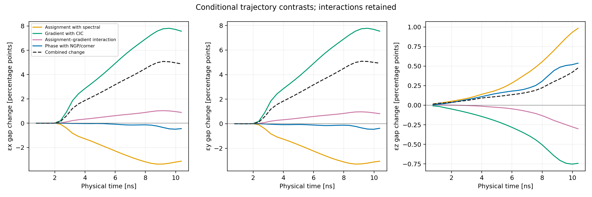
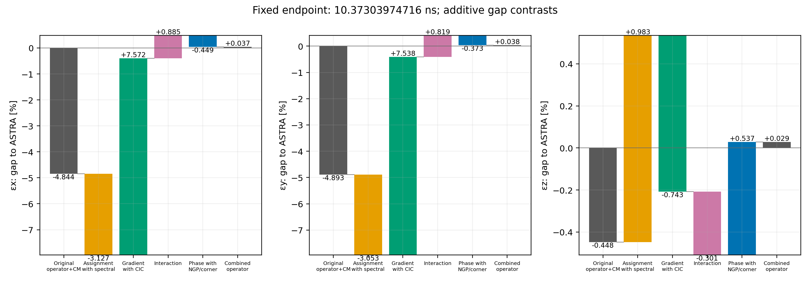

# ASTRA–OPALX EuXFEL discrepancies

Evidence for [OPALX issue #636: ASTRA-Discrepancies](https://github.com/OPALX-project/OPALX/issues/636).

**This is an archive of completed frozen-executable studies.** These tables
predate integration into the issue branch and its stationary-limit robustness
amendment. No new tracking was performed to prepare this archive or the commit.
The current branch uses an algebraically equivalent robust `hypot` evaluation
of the CM boost gamma and adds stationary/counterstreaming tests at normalized
momenta ±15 and ±15 with a 10⁻¹² perturbation. Do not interpret these archived
trajectories as a rerun of that later implementation. Fresh current-branch
[build/test validation](VALIDATION.md) passed all eight selected CTest suites;
it is separate from the historical study validation below.

The original spatial operator has not been shown physically wrong. The
consistent centre-of-momentum (CM) correction repairs a separate Lorentz-pair
inconsistency; it does not explain the approximately 4.9% transverse emittance
gap. At this finite mesh and population, NGP/corner at phase 0 meets 1% in all
three projected emittances at all 25 comparison clocks. A further half-cell
source phase improves compatibility, but is unnecessary for that criterion.
Agreement between two finite-grid calculations is not proof of physical accuracy.

## Conditions

The charged comparison begins at the same EuXFEL gun-exit checkpoint; cathode
emission is not rerun. Conditions are 100,000 equal-charge particles, −250 pC,
unchanged RF/solenoid maps, one energy bin, isolated OPEN boundaries without
images, cuboid-integrated Green function, 32³ grid points, nominal 1 ps timestep,
one MPI rank and four OpenMP threads. All five spatial controls use MIDPOINT;
a separate original-operator timing control changes only that placement to
PRESTEP. Actual ASTRA clocks remain authoritative because its requested step is
a maximum for collective RK4, rather than an assertion about every internal stage.

All comparisons use the same 25 actual saved ASTRA clocks, ending at
**10.37303974716 ns**. The OPALX primary moments are validated all-step 1 ps STAT
scalars, linearly sampled strictly inside native brackets. ASTRA values come
from its full actual saved particle population. No extrapolation, free drift,
core cut, charge fit, changed endpoint or modified species mass is used.

## Results

The gap is `100 * (OPALX / ASTRA − 1)`. Maximum columns contain absolute gaps
only at the 25 saved comparison clocks, not continuous-time error bounds.

| Case | Endpoint x [%] | y [%] | z [%] | Max 25-clock x [%] | y [%] | z [%] |
|---|---:|---:|---:|---:|---:|---:|
| Original OPALX, legacy boost | -4.833410 | -4.882504 | -0.483755 | 5.040576 | 5.047049 | 0.483755 |
| CM, CIC/spectral, phase 0 | -4.843882 | -4.892966 | -0.447801 | 5.049228 | 5.055684 | 0.447801 |
| CM, NGP/spectral, phase 0 | -7.970559 | -7.945736 | +0.535477 | 8.410932 | 8.328507 | 0.541090 |
| CM, CIC/corner, phase 0 | +2.728111 | +2.644868 | -1.190837 | 2.786631 | 2.733438 | 1.190837 |
| CM, NGP/corner, phase 0 | +0.486857 | +0.411166 | -0.508752 | 0.527869 | 0.486733 | 0.508752 |
| CM, NGP/corner, phase ½ | +0.037402 | +0.037987 | +0.028513 | 0.037402 | 0.037987 | 0.034910 |
| CM, CIC/spectral, PRESTEP | -4.849897 | -4.898902 | -0.449351 | 5.052003 | 5.058435 | 0.449351 |

NGP/corner phase 0 reaches maximum xyz gaps **0.527869%, 0.486733%, 0.508752%**.
Neither single assignment nor single gradient change meets the criterion.
The conditional tracked interaction is retained: the two changes cannot be
assumed additive. The historical CM reference and the same-build baseline
agree in spatial scalars within 7.424e−11% over 10,374 native steps.

At the endpoint, ASTRA has normalized emittances about 1.12602, 1.12618,
12.59870 µm rad; RMS sizes 0.424101, 0.424029, 1.216491 mm; mean kinetic energy
5.95111949 MeV and population RMS kinetic-energy spread 18.0461414 keV. All nine
observables and all cases are retained in the data below.

## CM consistency correction

For normalized mechanical momentum `p = P/(mc)`, let

$$
\bar p=\langle p\rangle,\qquad G=\langle\sqrt{1+p^2}\rangle,
\qquad \beta=\bar p/G.
$$

The matching boost gamma is

$$
\Gamma_{\rm CM}=\frac{G}{\sqrt{G^2-|\bar p|^2}}.
$$

The supported aligned single-bin OPEN/no-image correction consistently uses
this gamma for rest-mesh stretching, density normalization and field
reconstruction, while retaining the measured G for velocity. It adds no new
particle reduction or physical tuning parameter. Other solver/bin/image paths
retain their previous approximation. This remains an instantaneous bulk-frame
electrostatic closure, without internal rest currents, retardation or particle
time resynchronization. The current branch's stationary-limit evaluation
amendment is distinct from these archived simulation results.

## Definitions and units

Emittance is the centered, full-population mechanical normalized projected RMS
quantity `epsilon_nq² = Var(q) Var(pq/(mc)) − Cov(q,pq/(mc))²`. It is neither
canonical-solenoid emittance nor `x′ = px/pz` emittance; no extra π is inserted.
Equal macrocharges make count and absolute-charge population weighting agree.
Native rest energies are **ASTRA 511003.000003 eV** and **OPALX 510998.95 eV**.

| CSV field or quantity | Units / definition |
|---|---|
| `t` | Absolute physical time in ns |
| `emit_x_m`, `emit_y_m`, `emit_z_m` | Normalized mechanical projected emittance in m |
| `rms_x_m`, `rms_y_m`, `rms_z_m` | Population position standard deviation in m |
| `mean_kinetic_energy_eV` | Mean of full particle relativistic kinetic energies, eV |
| `rms_energy_spread_eV` | Population standard deviation of particle kinetic energy, eV |
| `relative_energy_spread` | Sampled RMS energy spread divided by sampled mean energy |
| `gap_percent` | `100*(value/ASTRA−1)` unless column names explicitly give another denominator |
| Factorial contrasts | Differences of gaps in percentage points, not percentages of the final discrepancy |
| Flow residual momentum | Physical eV/c, derived as `mc * epsilon_nq / sigma_q` |
| Flow signed linear slope | Physical eV/c/m, derived from signed native Pearson correlation |

Flow residuals remove only the best projected linear flow in the same spatial
coordinate. They include nonlinear deterministic flow, slice mixing, intrinsic
spread and numerical noise; they are not temperature or SC-only momentum.
STAT is in transported reference axes, while ASTRA source moments are in lab
axes. Independent saved-state checks and conservative all-step projection
bounds keep that distinction explicit. Sparse H5 covariance interpolation in
earlier reports is not silently substituted for this primary 1 ps scalar method.

## Case legend

| Observable CSV case | Flow CSV case | Meaning |
|---|---|---|
| `old` in historical references | `old` | Original OPALX, legacy boost and CIC/spectral operator |
| `CM` in historical references | `CM` | Earlier CM-only run, original spatial operator |
| `euxfel-baseline` | `baseline` | Same-build CM + CIC/spectral, phase 0, MIDPOINT |
| `euxfel-ngp-spectral` | `ngp-spectral` | CM + NGP/spectral, phase 0, MIDPOINT |
| `euxfel-cic-corner` | `cic-corner` | CM + CIC/corner, phase 0, MIDPOINT |
| `euxfel-ngp-corner` | `ngp-corner` | CM + NGP/corner, phase 0, MIDPOINT |
| `euxfel-astra` | `astra` | OPALX research NGP/corner, phase ½, MIDPOINT; **not the ASTRA code** |
| `euxfel-baseline-prestep` | — | Original spatial operator + CM, PRESTEP timing control |
| `ASTRA` reference column | `ASTRA` | Actual ASTRA saved particles |

Phase denotes the relative source-lattice sampling placement. Original mesh
origin and IPPL indexing are a paired convention; the result is not evidence
of a missing converter half-cell correction. The phase-0 combination already
meets the finite-benchmark target.

## Data

- [All six controls, nine observables, 25 clocks](tables/observables.csv)
- [Original and historical CM references](tables/historical-references.csv)
- [Six-control endpoint observations](tables/endpoint.csv)
- [Conditional trajectory-factor effects](tables/factorial-effects.csv)
- [All five spatial cases, references and projected flow](tables/flow.csv)
- [Projected-flow endpoint table](tables/flow-endpoint.csv)
- [ASTRA no-reuse control and original STAT comparison](tables/adaptation-effects.csv)

Every CSV and figure is copied byte-for-byte from the validated frozen study.
Full raw particles, executable/build products, research source code and large
runtime JSON records are intentionally outside this evidence archive. This is
a portable numerical/report archive, not a self-contained simulation restart.
Logical source fingerprints and the boundaries of each check are recorded in
[PROVENANCE.md](PROVENANCE.md). [DISCUSSION.md](DISCUSSION.md) develops the
physical and numerical interpretation and remaining questions.

## Figures

### Normalized emittance

[PDF](figures/emittance.pdf)

### RMS sizes

[PDF](figures/rms.pdf)

### Energy and energy spread

[PDF](figures/energy.pdf)

### Conditional emittance contrasts

[PDF](figures/emittance-factor-effects.pdf)

### Endpoint contrasts including interaction

[PDF](figures/endpoint-factor-effects.pdf)

### Projected residual momentum

[PDF](figures/residual-momentum.pdf)

### Coherent flow

[PDF](figures/coherent-flow.pdf)

### Inferred saved-state mesh geometry

[PDF](figures/adaptation-grid-geometry.pdf)

These pitches are inferred from saved particles using each code's frame and
geometry prescription. They are not captured native stage grids or the actual
intermediate ASTRA reused grid. The original geometry study retains its legacy
boost and source/target snapshot cadence; it is not a CM-only comparison.
Conditional nominal pitch equality requires identical particles, axes and frame
stretch. Both codes adapt their meshes; their policies differ between full solves.

### ASTRA reuse control

[PDF](figures/adaptation-reuse-effect.pdf)

This figure shows ASTRA fresh-minus-baseline changes, which are unchanged by
replacing the original OPALX measurement with validated 1 ps STAT scalars.
Disabling reuse changes sampled transverse emittance by at most 0.003604%.
The original STAT endpoint gaps versus fresh ASTRA remain
−4.830052%/−4.879075%. Logged Tcheck scaling ratios are prospective ratios at
full-rebuild checks, not direct measurements of intermediate applied reuse
corrections or force errors.

Lines between the 25 ASTRA clocks are visual guides. Inferred geometry and
fixed-state sensitivities are not rigorous evolved-trajectory error bounds.

## Validation and limits

The frozen study independently validated completion/inputs, full cohorts,
primary diagnostics, source identities, warm potential/interior E and the
conditional collection for all six controls. All 624 saved OPALX states in the
five-mode flow comparison and original/CM references, plus all 25 ASTRA states,
passed independent projected-flow checks. Native mass definitions, conservative
reference-axis bounds and the scalar measurement method are retained.

The warm replay starts from actual deposited RHS and rest pitches. It does
not independently reconstruct deposition from unavailable native midpoint
particles or replay the complete external-field Boris kick. Separate cold
native controls have exact-density/field/Boris coverage. The native ASTRA full
kernel and stage arrays remain unavailable.

The closest finite-grid answer is not established as the most accurate one.
Earlier 32³→64³ runs at fixed population change absolute transverse emittance
by 13–16%. Joint mesh/population, padding, and timestep convergence remains a
separate physical-accuracy question; a future cross-code crossing alone is
insufficient. The experimental mixed operator also has different discrete
conservation/self-force properties from original CIC/spectral.

Associated manual pages live in the separate `opalx-manual` repository and are
not part of this evidence bundle or repository commit. The current-branch
test commands and stationary-limit regression outcome are in [VALIDATION.md](VALIDATION.md).

## Integrity check

From this directory, run `shasum -a 256 -c SHA256SUMS`. The manifest covers all
bundle files except itself. Regenerate the manifest after any later edit or
file addition. CSV values and figure bytes were checked against
the immutable source artifacts during packaging; the archive changes no study
result, reference, tolerance or clock.
